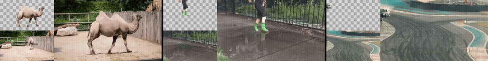

<div align="center">
<div style="text-align: center;">
    
    <h2>Over++: Generative Video Compositing for Layer Interaction Effects</h2>
</div>

<!-- <div class="is-size-5 publication-authors" id="div-row-authors">
    <span class="author-block">
    <a target="_blank" rel="noopener noreferrer" href="https://luchaoqi.com/">Luchao
        Qi</a><sup>1</sup>&nbsp&nbsp</span>
    <span class="author-block">
    <a target="_blank" rel="noopener noreferrer"
        href="https://scholar.google.com/citations?user=g2CuYi4AAAAJ&hl=en">Jiaye
        Wu</a><sup>2</sup>&nbsp&nbsp</span>
    <span class="author-block">
    <a target="_blank" rel="noopener noreferrer" href="https://chedgekorea.github.io/">Jun Myeong
        Choi</a><sup>1</sup>&nbsp&nbsp</span>
    <span class="author-block">
    <a target="_blank" rel="noopener noreferrer" href="https://www.imdb.com/name/nm0680288/">Cary
        Phillips</a><sup>3</sup>&nbsp&nbsp</span>
    <span class="author-block">
    <a target="_blank" rel="noopener noreferrer" href="https://www.cs.unc.edu/~ronisen/">Roni
        Sengupta</a><sup>1</sup>&nbsp&nbsp</span>
    <span class="author-block">
    <a target="_blank" rel="noopener noreferrer" href="https://www.danbgoldman.com/home/">Dan B
        Goldman</a><sup>3</sup>&nbsp&nbsp</span>
</div>
<div class="is-size-5 publication-authors" style="padding-top: 0.5em">
    <span class="author-block"><sup>1</sup>University of North Carolina at Chapel Hill &nbsp&nbsp </span>
    <span class="author-block"><sup>2</sup>University of Maryland &nbsp&nbsp </span>
    <span class="author-block"><sup>3</sup>Industrial Light &amp; Magic</span>
</div>
<br> -->
<div>
    <a href=https://overplusplus.github.io target="_blank"></a>
    <a href=https://github.com/luchaoqi/overplusplus target="_blank"></a>
    <a href=https://arxiv.org/abs/2512.19661 target="_blank"></a>
    <a href=https://x.com/QiLuchao/status/2003593587733479795 target="_blank"></a>
    <!-- <a href="https://opensource.org/licenses/Apache">
        
    </a>
    <a href="https://www.youtube.com/watch?v=S3zpLIMOU4c" target="_blank">
        
    </a> -->
    </br>
</div>

</div>


## ⭐ Update
❗ This is Luchao's implementation of Over++.
- [2026.02] Release the inference code


## ⚙️ Installation
- Recommended environment: python 3.10, CUDA 12.6, torch 2.9.1, diffusers 0.36.0.
- Please check [requirements.txt](./requirements.txt) for the dependencies.
- [Optional] Install SAM2 by following the [instructions](https://github.com/facebookresearch/sam2/tree/main?tab=readme-ov-file#installation).

### Model Weights 
Please download the following models. For CogVideoX-Fun-V1.5-5b-InP, you may also use the code below to download it.

```bash
mkdir -p models/Diffusion_Transformer
cd models/Diffusion_Transformer
git lfs install
git clone https://huggingface.co/alibaba-pai/CogVideoX-Fun-V1.1-5b-InP
```

| Model                                                                                     | Download link                                                                                         | Description                                                                                                                                                                                                                                                                          |
| ----------------------------------------------------------------------------------------- | ----------------------------------------------------------------------------------------------------- | ------------------------------------------------------------------------------------------------------------------------------------------------------------------------------------------------------------------------------------------------------------------------------------ |
| [CogVideoX-Fun-V1.5-5b-InP](https://huggingface.co/alibaba-pai/CogVideoX-Fun-V1.5-5b-InP) | [huggingface](https://huggingface.co/alibaba-pai/CogVideoX-Fun-V1.5-5b-InP) | Pre-trained inpainting model containing vae, encoder, transformer, etc. Please follow the instructions in [videox_fun](https://github.com/aigc-apps/VideoX-Fun) and save it to `models/Diffusion_Transformer/CogVideoX-Fun-V1.5-5b-InP`. |
| Over++                                                                                    | [huggingface](https://huggingface.co/luchaoqi/overplusplus)                                                                                | The model is a transformer module fine-tuned from VideoX-Fun's released inpainting model. This is not a full model, it only replaces the transformer weights of the CogVideoX-Fun-V1.5-5b-InP pipeline above. Please download the transformer weights and save to /PATH/TO/CHECKPOINTS                                                                                                                                                                                                           |

## ⚡ Inference


### Input Format
Prepare your input data in the following structure:
```
examples/
├── your-sequence-name/
│   ├── input_video.mp4         # Input video without effects
│   ├── trimask_00.mp4          # Mask with white for effect regions, black for unchanged regions, and gray for unknown regions (can be full gray mask video if no specific regions are to be changed)
│   ├── trimask_01.mp4          # Additional mask for inference (optional)
│   └── prompt.json             # Text prompt: {"bg": "A kid in rain boots runs through puddles, sending turbulent water splashing in all directions, with sprays shooting high into the air."}
```

### Single GPU Inference
You can run inference on a single GPU by running the following command example:

```bash
python inference/cogvideox_fun/predict_v2v.py \
    --config.experiment.save_foreground=True \
    --config.experiment.save_path="output_temp" \
    --config.data.data_rootdir="examples" \
    --config.experiment.run_seqs="boy-water,pexles_car_drift" \
    --config.experiment.skip_if_exists=False \
    --config.data.dilate_width=0 \
    --config.video_model.guidance_scale=6 \
    --config.video_model.transformer_path="PATH/TO/CHECKPOINTS/diffusion_pytorch_model.safetensors"
```

> **Note:** The `guidance_scale` is the CFG parameter that controls the trade-off between effect generation and content preservation. A higher value results in stronger effect generation but may also alter the original color tone. We recommend using a value between 2 and 20 (default: 6). A more advanced CFG formulation, such as [PickStyle - Video-to-Video Style Transfer | Pickford AI](https://pickstyle.pickford.ai/), may address this issue in the future.  
> Due to torch version compatibility issues, you may consider using `export PYTORCH_CUDA_ALLOC_CONF=expandable_segments:True` or installing [`flash-attn`](https://github.com/Dao-AILab/flash-attention) if having OOM errors during inference.

### Multi-GPU Batch Inference
You can run inference on multiple GPUs by running the following command example:

```bash
python inference/helper_inference_multi_gpu.py \
    --input_dir 'examples' \
    --output_dir 'output/your_output_dir' \
    --n_gpus 8 \
    --transformer_path 'PATH/TO/Over++/transformer.safetensors' \
    --prompt_guidance_scale 6
```


## 📷 Dataset

We construct a diverse training dataset combining **paired** and **unpaired** videos to enable effective effect generation while preserving the base model's text-to-video capabilities.

Please refer to [./dataset](./datasets) for more details.


## 🎓 Training

We follow the procedure [here](https://github.com/gen-omnimatte/gen-omnimatte-public/blob/main/scripts/cogvideox_fun/README_TRAIN.md) to fine-tune CogVideoX-5B inpainting model on 8 NVIDIA A6000 GPUs:

```bash
accelerate launch --use_deepspeed --deepspeed_config_file config/zero_stage2_config.json --deepspeed_multinode_launcher standard scripts/cogvideox_fun/train.py \
  --pretrained_model_name_or_path="PATH/TO/models/Diffusion_Transformer/CogVideoX-Fun-V1.5-5b-InP" \
  --train_data_meta="PATH/TO/datasets/train-casper/casper.json" \
  --image_sample_size=512 \
  --video_sample_size=256 \
  --token_sample_size=512 \
  --video_sample_stride=1 \
  --video_sample_n_frames=85 \
  --train_batch_size=1 \
  --video_repeat=1 \
  --gradient_accumulation_steps=1 \
  --num_train_epochs=5 \
  --checkpointing_steps=1000 \
  --learning_rate=2e-05 \
  --lr_scheduler="constant_with_warmup" \
  --lr_warmup_steps=100 \
  --seed=42 \
  --gradient_checkpointing \
  --mixed_precision="bf16" \
  --adam_weight_decay=3e-2 \
  --adam_epsilon=1e-10 \
  --vae_mini_batch=1 \
  --max_grad_norm=0.05 \
  --random_hw_adapt \
  --training_with_video_token_length \
  --random_frame_crop \
  --enable_bucket \
  --use_came \
  --use_deepspeed \
  --train_mode="casper" \
  --dataloader_num_workers=0 \
  --report_to="wandb" \
  --trainable_modules "." \
  --binarize_mask \
  --output_dir="training/PATH/TO/OUTPUT_DIR"
```

## 🙏 Acknowledgement
We thank the authors of [VideoX-Fun](https://github.com/aigc-apps/VideoX-Fun), [SAM2](https://github.com/facebookresearch/sam2), and [gen-omnimatte](https://github.com/gen-omnimatte/gen-omnimatte-public) for their shared codes and models.

We also appreciate the results from [Omnimatte](https://omnimatte.github.io/), [Omnimatte3D](https://openaccess.thecvf.com/content/CVPR2023/papers/Suhail_Omnimatte3D_Associating_Objects_and_Their_Effects_in_Unconstrained_Monocular_Video_CVPR_2023_paper.pdf), [OmnimatteRF](https://omnimatte-rf.github.io/), and [OmnimatteZero](https://dvirsamuel.github.io/omnimattezero.github.io/), as well as the videos on Pexels [[1](https://www.pexels.com/video/a-car-drifting-on-a-racing-track-4568686/),[2](https://www.pexels.com/video/a-sand-blowing-by-the-wind-4996615/),[3](https://www.pexels.com/video/waterfall-on-rock-formation-11867678/),[4](https://www.pexels.com/video/fahrrad-fahrt-durch-pfutze-27783285/),[5](https://www.pexels.com/video/swan-in-a-lake-854066/),[6](https://www.pexels.com/video/faceless-person-jumping-on-water-puddles-5844275/),[7](https://www.pexels.com/video/waterfall-on-rock-formation-11867678/),[8](https://www.pexels.com/video/toy-car-drifting-on-asphalt-10075365/),[9](https://www.pexels.com/video/av-motorboat-speeding-towards-the-seashore-2867877/),[10](https://www.pexels.com/video/faceless-person-jumping-on-water-puddles-5844275/),[11](https://www.pexels.com/video/boys-at-a-beach-7850849/),[12](https://www.pexels.com/video/a-truck-is-driving-through-a-muddy-field-27363070/),[13](https://www.pexels.com/video/time-lapse-of-sand-grains-being-blown-by-the-wind-13121064/)], which were used for fine-tuning Over++.

The views and conclusions contained herein are those of the authors and do not represent the official policies or endorsements of these institutions.

## 📑 Citation
If you find our repo useful for your research, please consider citing our paper:

```bibtex
@misc{qi2025overgenerativevideocompositing,
  title={Over++: Generative Video Compositing for Layer Interaction Effects},
  author={Luchao Qi and Jiaye Wu and Jun Myeong Choi and Cary Phillips and Roni Sengupta and Dan B Goldman},
  year={2025},
  eprint={2512.19661},
  archivePrefix={arXiv},
  primaryClass={cs.CV},
  url={https://arxiv.org/abs/2512.19661},
}
```
